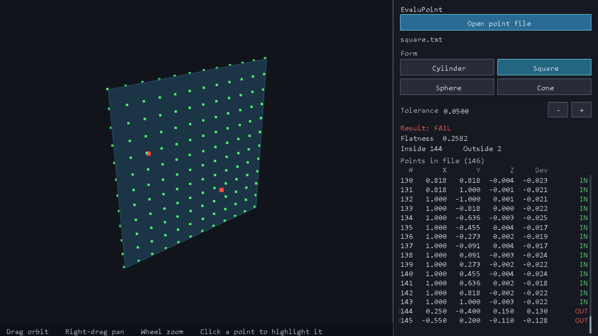
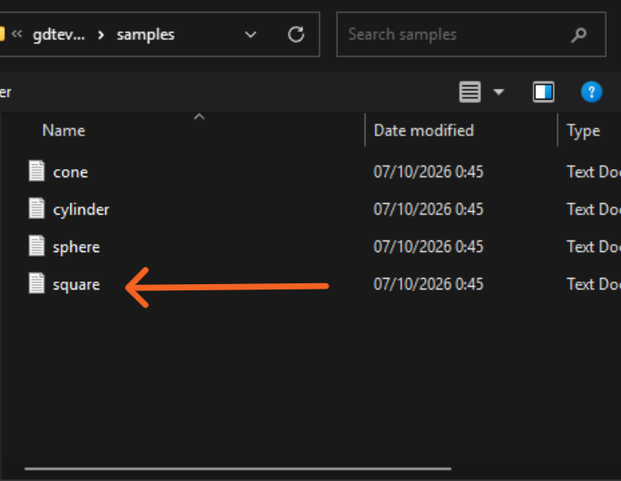
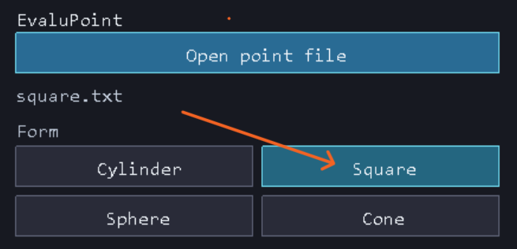
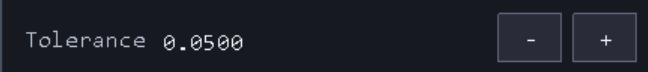
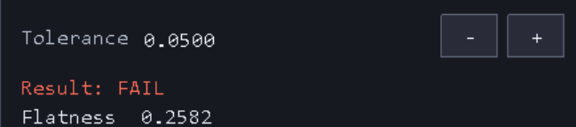
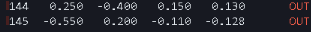
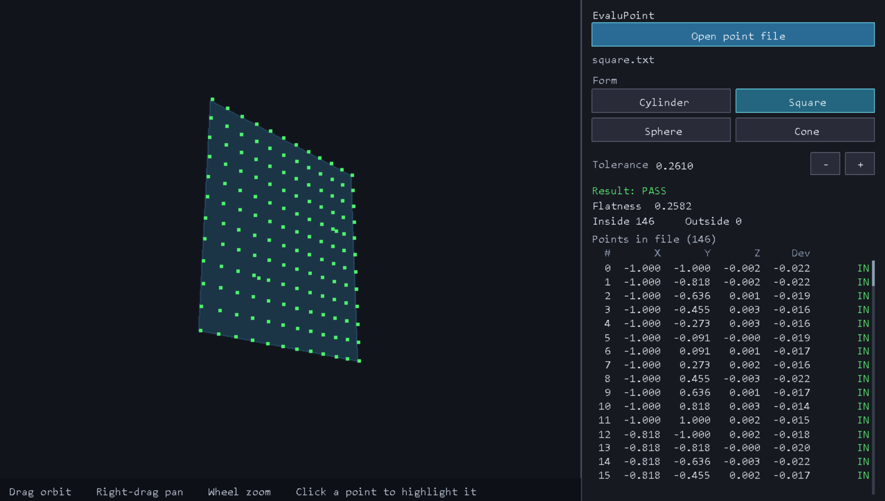

# EvaluPoint 1

EvaluPoint checks measured 3D points against a geometric form and a tolerance. It fits the shape, measures the form error, and marks each point inside or outside the tolerance zone.

The program is a small GD&T (geometric dimensioning and tolerancing) viewer for point clouds from a part measurement. It is meant to show whether a surface stays within the allowed form, and where the points that fall outside the zone are.

## What it checks

| Form | Check | Meaning |
| --- | --- | --- |
| Cylinder | Cylindricity | Gap between the smallest and largest radius about the fitted axis |
| Square plate | Flatness | Gap between two parallel planes that enclose the plate |
| Sphere | Sphericity | Gap between the smallest and largest concentric spheres |
| Cone | Cone form | Gap between two coaxial cones, measured perpendicular to the surface |

A check passes when the form error is within the tolerance you set. Points inside the zone are accepted. Points outside it are listed and highlighted.

## Point files

Each line is one point: `x y z`. Commas are treated as spaces. Blank lines and lines that start with `#` are skipped.

Sample clouds are in `samples/`:

- `cylinder.txt`
- `square.txt`
- `sphere.txt`
- `cone.txt`

## How to run

Open the viewer with the sample cylinder:

```
gdtevaluator
```

Open a file in the 3D view:

```
gdtevaluator cylinder samples/cylinder.txt 0.05
gdtevaluator square samples/square.txt 0.05
gdtevaluator sphere samples/sphere.txt 0.05
gdtevaluator cone samples/cone.txt 0.05
```

Print a text report and skip the window:

```
gdtevaluator --report-only cylinder samples/cylinder.txt 0.05
```

Run the built-in geometry checks:

```
gdtevaluator --self-test
```

In the window, drag to orbit, right-drag to pan, and use the wheel to zoom. The side panel opens another point file, switches form, and raises or lowers the tolerance. Keys 1 to 4 select cylinder, square, sphere, and cone.

On startup a small **EvaluPoint 1** window appears while the viewer is set up, then closes.

## Screenshots

The main window fits the chosen form and draws every measured point. Green points are inside the tolerance zone. Red points are outside it. This square plate fails flatness: 144 points are inside and 2 are outside.



**Open point file** loads a measured cloud. The samples are text files of `x y z` points. Here `square.txt` is selected.



The form buttons run a different check on the same points. **Square** is selected, so the check is flatness.



The **−** and **+** buttons change the tolerance. The pass or fail result updates as soon as the value changes.



The check fails when the form error is larger than the tolerance. Flatness 0.2582 is outside a tolerance of 0.0500, so the result is **FAIL**.



Points that fall outside the zone are listed in red and marked **OUT**.



Raising the tolerance until it covers the form error turns the same cloud into a **PASS**. At 0.2610 every point is inside the zone.



## Build

Windows, C++17, with OpenGL. From the project folder:

```
g++ -std=c++17 -O2 -o build/gdtevaluator.exe main.cpp -lcomdlg32 -lglu32 -lopengl32 -lgdi32 -luser32
```

Or with CMake:

```
cmake -S . -B build
cmake --build build
```
